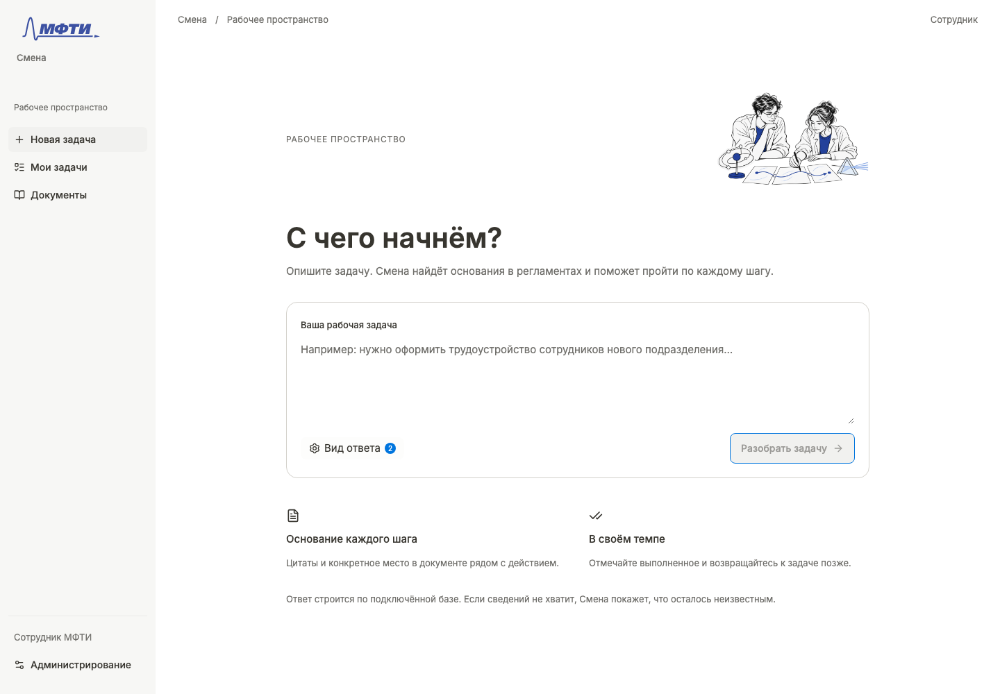

# Смена · frontend

Рабочий интерфейс по [UI kit и флоу Figma](https://www.figma.com/design/jORhjmSwUojzxk4ZGo9OI5?node-id=49-505). React19, TypeScript, Vite, UI SDK и Cult UI; цвета, интервалы, радиусы и типографика взяты из114 токенов Figma. Шрифт Inter поставляется локально.



## Запуск

Основной способ — Docker Compose из корня репозитория по существующей [инструкции бэка](../materials/DEPLOY.md). Dockerfile собирает frontend отдельным Node-этапом и включает результат в FastAPI. После настройки документов, модели, PostgreSQL и `.env`:

```sh
docker compose up -d --build api import-worker
```

UI открывается на `/`, прежняя демонстрационная страница сохранена на `/legacy`, прежняя карта — на `/map`. API маршруты остались совместимы. Продакшен работает с API на том же origin; CORS и отключение проверок безопасности не нужны.

Для разработки нужны Node≥22.12 и pnpm11.25.0. Сначала запустить backend по его инструкции, затем:

```sh
cd frontend
corepack pnpm install --frozen-lockfile
corepack pnpm dev
```

Vite открывается на `http://127.0.0.1:5173` и проксирует `/api` и `/health` в `http://127.0.0.1:8000`. Адрес можно изменить серверной переменной `NAVIGATOR_API_URL`. Ключи модели, почты и администратора в VITE-переменные не помещать. Для отдельной сборки выполнить `pnpm build`; результат — `frontend/dist`. FastAPI в Docker получает его автоматически.

## Пользовательский сценарий

1. Сотрудник вводит задачу. POST `/api/query/stream` показывает фактические стадии поиска и генерации. Ошибки сохраняют введённый текст и не подменяются демоответом.
2. `answer.steps` формируют план; у каждого шага независимая отметка. Ключевые выводы и действия связаны с `citation_ids`.
3. При открытии этапа видны действие и список оснований под ним. Каждое основание раскрывается по клику и показывает цитату. «Разобрать этот шаг» повторно обращается к RAG для подробностей именно выбранного действия; исходный план и отметки сохраняются.
4. Источник загружается по точному source_id. UI выделяет start/end в block_text, проверяя совпадение с quote. При недоступности источника показывает ошибку, сохраняя задачу.
5. «Продолжить» открывает первый невыполненный этап. Завершение доступно после всех отметок. Оно отражает действия пользователя, а не проверку результата в HR или иной внешней системе.
6. Запрос недостающего материала с явным согласием поступает в серверную очередь. Подтверждение показывается только после успешного201.

До50 последних задач, их ответы и отметки сохраняются в localStorage данного браузера. Межустройственной синхронизации нет. Ошибка сохранения видна пользователю. Удаление данных браузера удаляет его локальный прогресс. При `steps=[]` интерфейс не выдумывает процедуру и не предлагает фиктивное завершение.

Пример1: вопрос о бронировании зала → реальные шаги и цитаты подключённого корпуса → отметки → возврат из «Моих задач». Пример2: вопрос вне базы → реальный not_found/partial → просмотр найденного → запрос материала. Сценарий трудоустройства из Figma воспроизводим только при наличии соответствующего публичного HR PDF в разрешённом индексе; ответы из макета в приложение не зашиты.

## Администрирование

- Регламенты: каталог реальных документов из `/api/map`; строка открывает полный извлечённый текст выбранной версии через `/api/documents/{id}?corpus_revision=…`, со страницами/блоками и предупреждениями. Недоступный документ показывает ошибку; устаревший корпус —409.
- Импорт: PDF/DOCX/XLSX до25МБ или публичная прямая ссылка; согласие, замена, очередь, heartbeat обработчика, duplicate, partial, warnings и failed. Новая редакция становится доступной после завершения фоновой индексации.
- Граф: круглые узлы документов, тем и вопросов из `/api/map`, тонкие смысловые связи. Поиск, перетаскивание поля и узлов, масштаб относительно курсора, fit, фильтры и полноэкранный режим. Все узлы доступны через поиск и с клавиатуры. Фрагменты привязаны к corpus_revision, stale требует перепроверки. Смысловая близость не объявляется нормативной зависимостью. Неподтверждённый вопрос не считается автоматически дефектом регламента.
- Проверка регламентов: POST `/api/map/questions` с явным согласием на публичный вопрос; реальные результаты, недостающие сведения и перепроверка.
- Запросы материалов: общая SQLite-очередь; new/review/closed. Файл `MATERIAL_REQUEST_DB`, по умолчанию `data/workspace/requests.sqlite`, сохраняется volume Compose.
- Почта: реальные settings/status/event поля существующей ветки `codex/mailbot`, включённой в эту ветку. Все7 статусов журнала сохранены; uncertain не превращается в sent/failed. Нет выдуманной кнопки повторной отправки. Фоновое обновление раз в10с не затирает изменяемую форму.

Для почты и общей очереди задайте `ADMIN_API_TOKEN` на сервере, затем введите его в поле «Доступ администратора». Ключ хранится только в памяти страницы и не включён в сборку. Полноценная корпоративная аутентификация не реализована; остальные публичные demo API сохраняют существующую модель доступа.

Шлюз `/api/admin/mail/*` обращается к заданному на сервере `MAILBOT_PANEL_URL`, сохраняя внутренние Host/Origin проверки почтовой панели. Пароли IMAP/SMTP остаются в серверном secret. Отдельный почтовый сервис можно подключить через опциональный override:

```sh
# Настроить MAILBOT_ADDRESS, ADMIN_API_TOKEN и secrets/mail_password.
# Каталог data/mailbot должен быть доступен UID10001 — см. mailbot/README.md.
docker compose -f compose.yaml -f compose.mailbot.yaml up -d --build
```

В override почтовая панель доступна только по внутренней сети Compose. Для этого режима нужен настроенный ящик; запуск worker обрабатывает реальные письма. Без MAILBOT_PANEL_URL интерфейс показывает, что почта не подключена, и не подставляет фиктивные события.

## Дизайн и библиотеки

`design-system/` содержит источник токенов, manifest, правила, карту флоу и QA макета. Генерация:

```sh
pnpm tokens
```

Компоненты находятся в `src/components/`, API-адаптер и состояние задач — `src/lib/`. UI SDK управляет фокусом и закрытием модальных окон. Cult Halo Search используется для поиска задач/регламентов; AI Instructions — для настроек отображения ответа. Эти настройки не меняют системный промпт и правила доказательности. Эффекты ограничены строгой светлой палитрой. Происхождение иллюстраций и лицензии компонентов — `THIRD_PARTY_NOTICES.md`.

## Проверки

```sh
pnpm build
pnpm test
pnpm exec playwright install chromium
# Python из установленного окружения бэка:
NAVIGATOR_TEST_PYTHON=../.venv/bin/python pnpm test:e2e
```

E2E-сервер использует реальные FastAPI маршруты, SSE, resolver источников, форму импорта, очередь материалов и шлюз почты. Retrieval, модель, worker, карта и upstream почты заменены явно синтетическими фикстурами. Это проверяет взаимодействие UI и API; качество RAG на реальных регламентах такими тестами не доказывается. Ни одно тестовое письмо не отправляется.

14 ноября2026: production build,7 unit-тестов и22 браузерных сценария; ширины320/390/1024/1440/1920. Backend:154 passed,5 skipped (нет внешнего тестового PostgreSQL). Рабочий `https://smena-mipt.ru` дополнительно проверен: health ready, настоящий RAG-ответ на публичный демонстрационный вопрос, точное совпадение цитаты с диапазоном исходного блока. Реальная отправка почты и чистый Docker-запуск здесь не проверялись — Docker на рабочем Mac недоступен. Настоящие регламенты, секреты и ответы рабочего корпуса в Git не включены.

## Graphify

Graphify0.9.108 установлен локально и зарегистрирован для Codex в `.codex/skills/graphify`. Для переноса на другую машину установить официальный CLI: `uv tool install graphifyy`. Затем:

```sh
graphify extract . --code-only --no-cluster --max-workers 2
graphify query "create_app install_routes" --budget 800
graphify affected "create_app" --depth 1
```

Код анализируется локально через AST. Кэш graphify-out исключён из Git. SQL-схема проверяется по исходнику: SQL parser в этом окружении отдельно не установлен.

Graphify пропустил3 файла по эвристике имён: design-tokens.css, smena-design-tokens.css и smena-design-tokens.json. Это UI-токены; их aliases и CSS-ссылки проверены напрямую.

После отмены клиентского запроса уже начатый вызов модели может завершаться в серверном потоке. Кратковременный429 в этот момент показывает существующее сообщение «Модель обрабатывает другой вопрос» и действие повтора; новая задача не заменяется отменённым ответом.

## Изменения1.3.0

Исправлены двойная рамка составных полей и визуальные состояния checkbox. Источники стали раскрываемыми строками; увеличены интервалы текста и действий. Официальный логотип МФТИ и три оригинальные научные иллюстрации поставляются локально. Происхождение и описания генерации: [asset manifest](public/illustrations/asset-manifest.json).

Токены сохранены из Figma1.2.0 без изменений. Frontend-контракт и руководство1.3.0 актуализированы; нативная синхронизация Figma пока pending_connection — Local Bridge не подключён. Статус фиксируется в design-system/smena-component-manifest.json. Развёртывание обновления в production в этой задаче не выполнялось.
