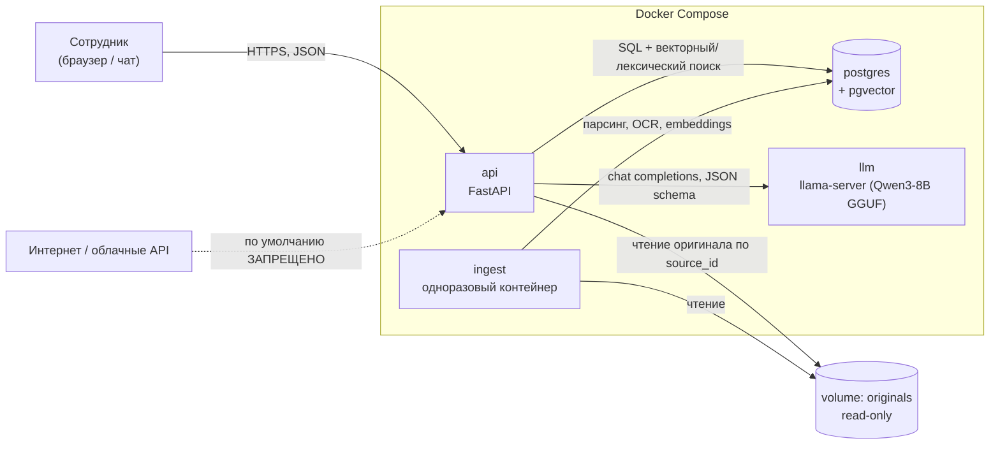
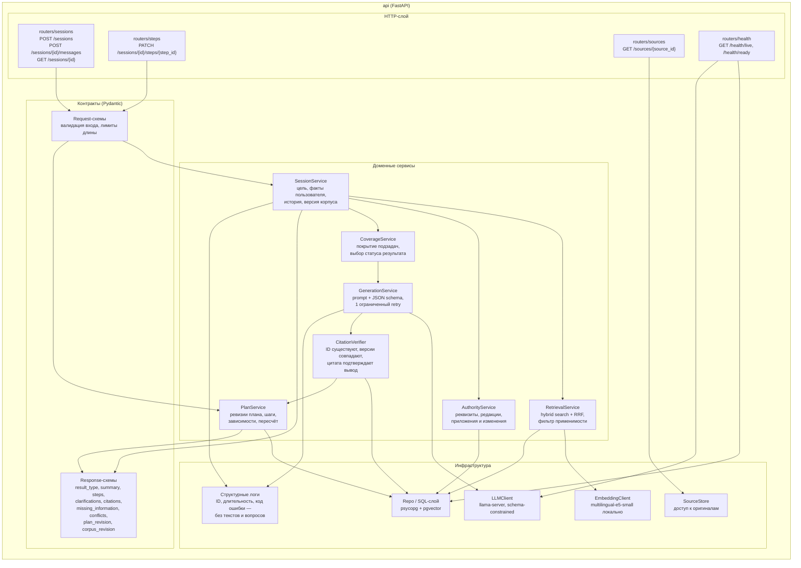
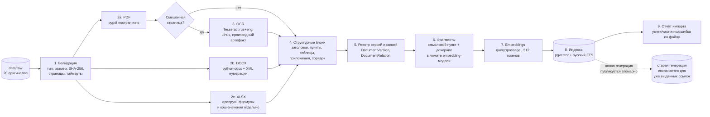
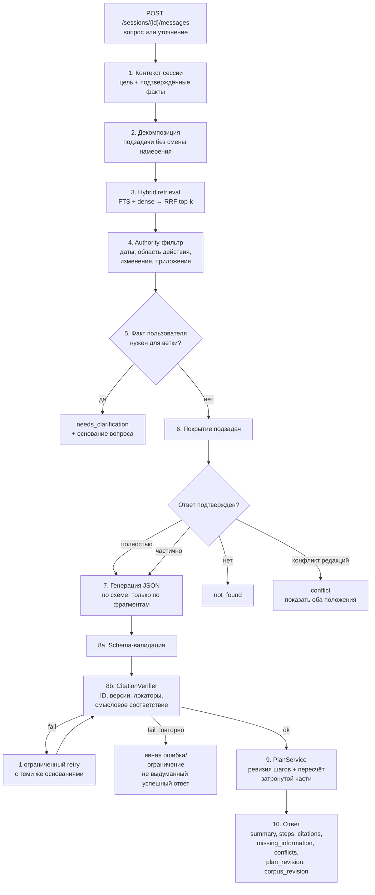
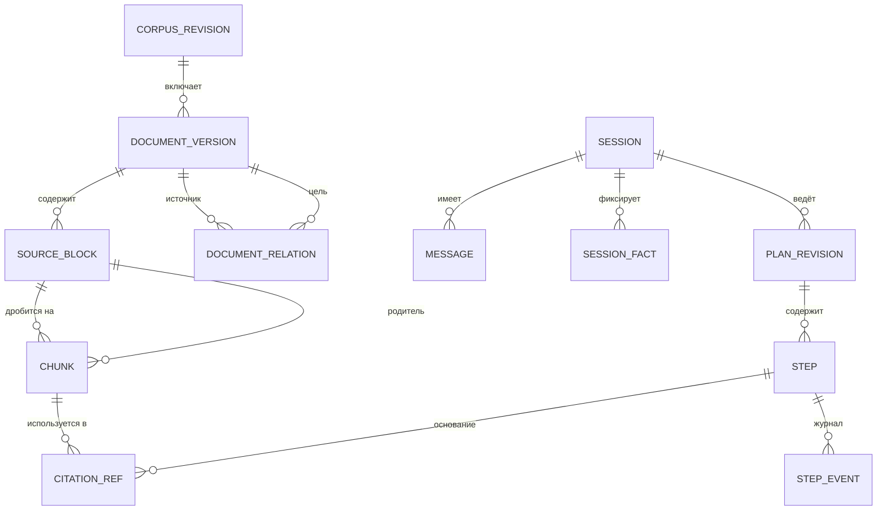
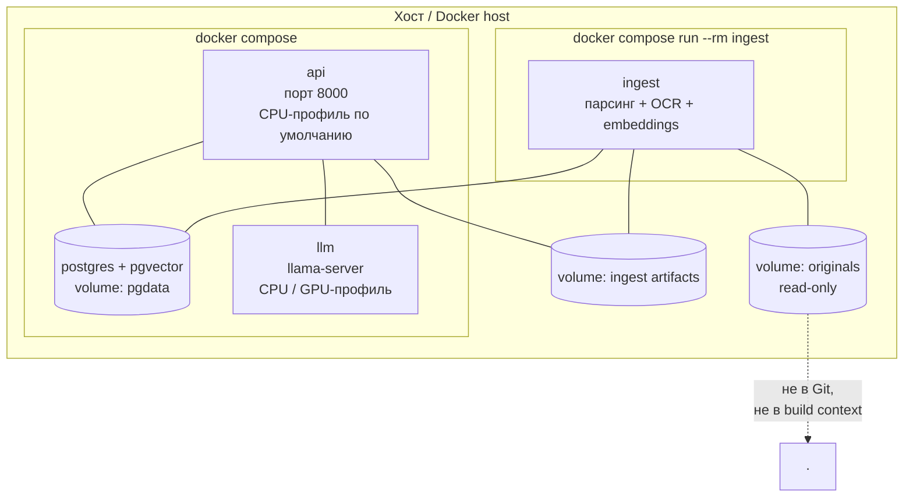

> Текущий реализованный профиль описан в [DEPLOY.md](DEPLOY.md): FastAPI → локальный поиск E5/pgvector → внешний Qwen 27B → проверка структуры и ссылок → ответ. Локальный llama-server, AuthorityService и PlanService в схемах ниже — план развития, не работающие компоненты.

# Бэкенд: архитектура и зоны ответственности

Статус: **целевая схема по [BACKEND_PLAN.md](BACKEND_PLAN.md)**. Первый этап ingest и поиск фрагментов реализованы; запуск и ограничения — в [INGEST.md](INGEST.md). API и LLM-генерация реализованы в профиле из DEPLOY.md; проверка применимости и сопровождение состояния процедуры остаются проектными. Диаграммы описывают целевую систему, а не отчёт о полной реализации.

Обозначения: сплошная стрелка — синхронный вызов, пунктирная — асинхронный/одноразовый процесс, `[ ]` — контейнер, `( )` — внешний ресурс.

---

## 1. Контекст: кто с кем взаимодействует

Три процесса, одна БД. Тяжёлая индексация не живёт внутри HTTP-запроса: `ingest` запускается отдельно и публикует готовую генерацию индекса атомарно.

---

## 2. Компоненты API (внутреннее устройство)

Разделение намеренное: **модель предлагает, сервер проверяет**. LLM не формирует URL, названия документов и локаторы — их подставляет сервер из реестра.

---

## 3. Поток подготовки базы (`ingest`)

Ключевые инварианты:

- оригинал не перезаписывается результатами извлечения;
- OCR — отдельный артефакт с пометкой метода, не «безошибочная транскрипция»;
- номер страницы для DOCX не выдумывается (локатор = путь заголовков + индекс блока + точный фрагмент);
- пустой кэш формулы в XLSX не превращается в ноль и не называется проверенным расчётом;
- повторный импорт того же хеша не создаёт дублей, изменённый файл создаёт новую версию.

---

## 4. Поток ответа на вопрос

Статусы результата: `answered`, `needs_clarification`, `partial`, `not_found`, `conflict`. Технические сбои (нет индекса, недоступна модель, ошибка БД) — **отдельные коды**, никогда не `not_found`.

Похожесть поиска не равна наличию ответа: низкое покрытие отличается от поломки индекса, и пользователю показывается разная причина.

---

## 5. Модель данных

| Сущность | Ответственность | Что важно не потерять |
|---|---|---|
| `DocumentVersion` | Стабильный ID документа + конкретная версия, хеш, реквизиты, дата подписания, период действия, статус применимости и конфиденциальности, результат импорта | Дата подписания ≠ дата вступления в силу ≠ период применения |
| `DocumentRelation` | Приложение / изменение / отмена / замена, область изменения, основание-фрагмент, статус подтверждения | Точечное изменение не означает полную замену документа |
| `SourceBlock` / `Chunk` | Исходный и нормализованный текст, заголовки, пункт, локатор, метод извлечения, родитель, версия embedding-модели | У каждого фрагмента есть ID, локатор и исходный текст для проверки цитаты |
| `Session` / `Message` / `SessionFact` | Цель, сообщения, подтверждённые факты пользователя, нерешённые уточнения, версия корпуса | Факт «со слов пользователя» ≠ нормативное утверждение |
| `PlanRevision` / `Step` | Действие, условия применимости, зависимости, статус, ссылки на основания | Нормативное требование отделено от состояния пользователя |
| `StepEvent` | Кто и когда отметил шаг, версия плана | `done_by_user` ≠ фактическое согласование или проверка организацией |
| `CorpusRevision` | Атомарная публикация генерации индекса | Уже выданные ссылки продолжают указывать на ту версию, по которой отвечали |

---

## 6. Развёртывание

- `api` — единственный публичный процесс; `postgres`, `llm`, `ingest` наружу не смотрят.
- Оригиналы монтируются read-only; `.dockerignore` исключает данные, логи, секреты.
- Версии Python, зависимостей, контейнеров, весов, токенизаторов, GGUF, chat template и схем фиксируются; плавающий `latest` не считается воспроизводимой конфигурацией.
- Вариант «модель на хосте (Metal на Mac)» — только через конфиг адреса, не скрытая зависимость; самостоятельный Linux CPU/GPU путь обязателен.

---

## 7. Здоровье, ошибки и границы

| Проверка / ситуация | Поведение |
|---|---|
| `GET /health/live` | Процесс жив; не проверяет зависимости |
| `GET /health/ready` | Проверяет БД, доступность модели и наличие корпуса; при провале — причина, а не общий `not_found` |
| Нет индекса / модели / БД | Технический код ошибки + понятная причина; readiness неуспешна |
| Повреждённый или неподдерживаемый файл | Ошибка импорта с именем файла; импорт помечается частичным |
| Долгая операция | Таймауты, лимиты контекста и параллелизма, отмена запроса |
| Невалидная генерация | Один retry, затем явное ограничение |
| Внешний API | По умолчанию выключен; автоматического fallback в облако нет |
| Логи | Технические ID, длительность, коды; тексты документов, вопросов и ответов не пишутся |

Сознательно **не входит** в первую реализацию: Redis, Celery, отдельная векторная БД, Elasticsearch, LangChain/LangGraph, многоагентность, авторизация и внешние интеграции, генератор тренажёра.

---

## 8. Что где менять

| Хочу изменить | Модуль |
|---|---|
| Новый формат документа | `ingest`: новый extractor + регистрация в отчёте импорта |
| Качество поиска | `RetrievalService` (веса RRF, top-k), `EmbeddingClient` |
| Правила приоритета редакций | `AuthorityService` + `DocumentRelation`, не промпт |
| Формат ответа | Pydantic response-схемы + `CitationVerifier` |
| Логику шагов и пересчёта | `PlanService`, `PlanRevision`/`Step` |
| Модель генерации | `LLMClient` + конфиг, без изменения доменных сервисов |

## 9. Реализованный импорт из браузера

Файлы и публичные ссылки добавляются в единый активный корпус. API сохраняет файл в `data/imports/<job_id>/original/` или ставит скачивание в постоянную очередь PostgreSQL. Отдельный процесс `navigator.imports.worker` получает задачу с арендой и heartbeat; после сбоя просроченная задача может быть повторена. Ссылка с её параметрами не возвращается в API статуса и очищается из очереди после завершения.

Обработчик скачивания проверяет публичность адресов при фактическом TCP-подключении, соединяется с проверенным IP и заново проверяет каждый редирект. Извлечение использует существующий ограниченный subprocess; OCR и эмбеддинги выполняются локально. Ключ генерации не монтируется в контейнер обработчика.

Для нового документа вычисляются только его эмбеддинги. Существующие документы и векторы берутся из закреплённого снимка. `Store.publish(expected_active=...)` под блокировкой проверяет, что активный корпус не изменился; при конфликте обработчик заново собирает полный снимок. Публикация меняет указатель атомарно. Совпадение SHA-256 не создаёт новую версию; замена одноимённого документа требует явного согласия, прежние источники сохраняются для старых ссылок.

Исходный комплект по-прежнему индексируется CLI. Отчёты извлечения и оригиналы не входят в Git или Docker-образ. Параметры запуска, лимиты и статусы браузерного импорта описаны в [DEPLOY.md](DEPLOY.md#загрузка-документов-из-интерфейса).
